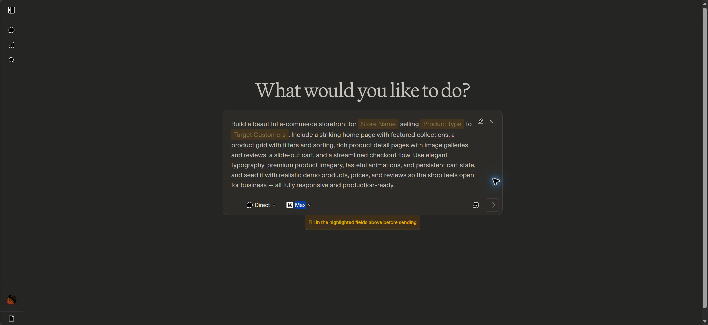

# Arena 提示词模板阻塞发送：发现与桥接修复

记录日期：2026-10-19，UTC+8。应用候选：1.5.17，源码 `f43429238b391bc8f317fc25b6521f5a37cdb2af`。记录时生产仍为 1.5.16，Arena 真实推理尚未恢复。

对应[生产恢复规格](../requirements/ARENA_PRODUCTION_RECOVERY_2026-10-19.md)。本报告保留这次新增的网页状态和排查方法，避免以后把不同阻断混为同一问题。

## 新发现

用户截图中的输入区处于 **Code Arena 的 Prompt template 模式**，模板内有 `Store Name`、`Product Type`、`Target Customers` 三个高亮必填项。没有填写时，网页提示：

> Fill in the highlighted fields above before sending

该状态下不能直接发送。它是当前模板的表单校验，不是普通聊天每次都必须填写的字段，也不是验证码。



通过本机 Edge 实际页面核对，截图页面是 `/code/direct?model_a=max`。生产 Arena Runtime 的配置则是：

```text
page_path = /text/direct?model_a=max
chat_path = /nextjs-api/stream/create-evaluation
```

**目前没有证据证明生产的官方 403 是这个 Code 模板引起的。** 模板确实暴露了输入准备的一项兼容缺陷，需要单独修复并保留回归。

## 引入位置与检查遗漏

通过 `git log -S` 追溯，`8e8e5e759185db6f8dbf3580138e01898e989307`（1.5.7）新增 `_capture_native_submission`，使用了 `page.locator("textarea").first` 后直接填入、按 Enter 的方式。该实现没有识别模板，也没有排除网页测量用 textarea。

这是本项目改动中的兼容性缺陷，之前验收未覆盖这两种真实 DOM 状态，属于检查遗漏。不能以当时已有单元测试通过作为输入准备完整正确的证明；本次增加真实浏览器夹具对照和原生提交内容核对。

用户提出“模板验证未通过可能导致 403”的假设，一并纳入排查。已有 16:38 的两个真实原生样本（0.30.0、1.5.16）各实际提交一条，提交内容均与字面量“你好”匹配，端点均为 `create-evaluation`，官方响应均是 403、39 bytes、`recaptcha validation failed`。这些样本已经越过输入表单，不能直接归因为未填模板字段。修复候选还需按同账号/同出口验证，避免仅凭错误码断言原因。

## 可观察状态与定位方法

| 状态 | 页面/网络证据 | 判断与处理 |
| --- | --- | --- |
| 模板未完成 | 存在 `Prompt template`、必填输入和 `Exit template`；发送不可用，尚无生成 POST | 先退出模板，再填入下游原始提示词；不能凭空补写店名、商品或客群 |
| 错误输入框 | 页面有隐藏测量用 textarea，`aria-hidden="true"`、`tabindex=-1`；不是实际消息编辑器 | 禁止仅用 `textarea.first`；选择可见的 `textarea[name="message"]` |
| 普通输入就绪 | 编辑器读回值与准备文本一致，`Send message` 可用 | 只证明可以提交，不证明厂家已生成 |
| 上游验证拒绝 | 已有生成 POST，官方返回 `403 / recaptcha validation failed`，无正文和完成事件 | 按官方验证故障记录；退出模板或填写文字不能证明已经修复 |
| 当前会话身份未确认 | `/api/me` 返回 200，但返回身份与保存的 profile ID、Supabase subject 均不匹配 | 停止生成并检查认证状态；HTTP 200 本身不能证明已登录到预期账号 |

同一页面可能同时存在模板状态和 reCAPTCHA 服务连接警告，必须按 DOM、生成请求是否发出、原始响应三类证据分别判断。

## 1.5.17 的桥接行为

涉及 `automation/any2api_automation/providers/arena_browser.py` 的原生提交准备流程：

1. 先安装本次请求的 route 拦截，出现可见的 `Exit template` 时自动退出模板。
2. 定位可见、命名为 `message` 且非 `aria-hidden` 的 textarea，填入实际客户端文本并读回核对。
3. 点击明确的 `Send message`，核对捕获请求的 `userMessage.content`，拒绝旧草稿或模板残留。
4. 原生准备提交在本地以 418 截止，只提取本次新上下文；厂家实际生成仍沿用既有规范桥接正文，避免准备请求重复消耗额度。
5. 准备失败、内容不匹配、超时或取消时移除本次 route，不将准备失败误记为厂家已处理。

UI 准备按 textarea 规则统一换行，允许网页裁掉首尾空白；规范桥接正文仍保留客户端原文。空文本附件请求的既有准备占位保持。下游 OpenAI Chat/Responses 契约、工具/系统提示语义、代理绑定、账号初检预算和其他厂商均不变。

不自动捏造模板字段值。对于当前 OpenAI 文本入口，退出网页模板后传入原文，才能保持请求含义。

## 已完成的验证

- **真实网页控件**：本机 Edge 的 Code 页面已自动点击 `Exit template`，随后填入字面量“你好”，普通消息输入框恢复、`Send message` 可用；没有为此额外发送 Code 生成请求。
- **旧版反例**：使用生产 1.5.16 不可变镜像和包含模板、隐藏测量框的本地夹具，第一条准备约 30.377 秒超时；0 条厂家生成。该反例说明旧输入准备不能处理此状态，不说明生产当时真的处于模板中。
- **单元回归**：`automation/tests/test_arena_submission.py` 最新 21 项通过；覆盖模板/普通输入、隐藏框、原生内容不匹配、草稿变化、换行/Unicode/附件、前端首尾空白处理和异常清理。
- **构建**：候选 [CI 39226272037](https://github.com/Prodigalgal/any2api/actions/runs/39226272037) 已成功，Automation 728 项通过，Backend/Web 质量、版本元数据、浏览器基础镜像和应用镜像构建通过；`deploy=false`，GitOps 更新未执行。
- **候选容器**：最终 Arena 镜像 digest `sha256:18c4be7b2966eb843ea6e086afb79e06b392a3d3a44e1250721917e5b40caa40`。Chromium 有窗口、Chromium 无窗口、Camoufox 有窗口各 12 项，共 36/36 通过；每组轮换 6 次模板、6 次普通输入，隐藏测量框保持不变，12 次上下文互不重复。覆盖复用/并发、403/429、交互验证要求、超时、取消、帧上限及失败后复用；0 条真实厂家请求。
- **资源回收**：上述三组全部关闭后，浏览器预算 `in_use=0`、浏览器进程为空、夹具连接为 0；三个临时 Job 已删除。
- **真实候选复测，17:25**：同历史账号、原 Sophia 出口、1.5.17 不可变镜像、有窗口 Chromium。页面无模板、可见命名消息框 1 个、隐藏 textarea 1 个，认证身份匹配；原生准备的内容/模型/模式/字段与规范正文一致，取得本次新上下文。只放行 1 条真实生成，官方仍为 `403 / recaptcha validation failed`，无正文/完成事件。为保留第一次拒绝，诊断中关闭 v2 后续交互，不自动解验证或重试；没有改生产配置。
- **真实复测回收**：Job `any2api-arena-template-20261019092533` 已删除，浏览器预算/进程与代理引用归零。此前一轮诊断因设置写入错误配置类，在执行 main 前退出，未获得生成结论；修正诊断脚本后才执行上述一次正式复测，不将启动错误算作厂家 403。
- **待补验收**：官方验证通过后的正文、完成事件和连续复用。当前证据证明输入准备修复已生效，但尚未修复这次验证拒绝，模拟通过不等于 Arena 真实恢复。

本机控件操作和旧版夹具的证据保存在本地忽略目录；未把 Cookie、Token、API Key、账号资料或会话正文写入报告。

17:24 生产只读复核：四组件实际仍为 1.5.16、digest 匹配、Ready、0 重启，Argo `Synced/Healthy`，GitOps `f65dc8ccaf167e86b4868183f2e8688e431bfe71`。DeepSeek/Qwen 为 0 副本。当前本机浏览器工具重新提示访问被 Work 设置禁用，无法追加截图或把历史页面当作新的可用性证明。

## 本轮环境对齐试验的边界

追加的一次隔离 Camoufox 试验对齐了本机已观察到的语言、时区、CPU 报告值、屏幕尺寸和 DPR。浏览器报告 Windows/Firefox 环境，不代表底层 Linux ARM64 变成实体 Windows/x64，也不代表获得本机 GPU。

这轮 `/api/me` 返回 200，但预期 profile/subject 两种身份比较均未匹配，流程在认证阶段结束，**真实生成请求数为 0**。不能将它记为环境对齐后仍收到 403，更不能据此判定该配置有效。对应独立 Job 已删除，浏览器预算、代理池引用均归零，未修改生产账号或重置初检。

## 服务器会话对照（临时 POC，已关闭）

为继续检查被拒绝的实际服务器会话，17:32 准备了临时私有入口，展示隔离 Job 内真实浏览器；启动时预期账号身份匹配、普通消息框就绪。后续出现官方图块验证，用户分两次授权共 6 次内部 AI 调用，均已用完且未通过；重复识别灰化等待画面的诊断遗漏已更正。约 18:02 入口到期关闭，最终 1 次 Arena 生成、0 有效输出。完整结果见[Camoufox 与验证报告](ARENA_CAMOUFOX_AND_RECAPTCHA_2026-10-19.md)。

- Job：`any2api-arena-operator-20261019093217`；使用同一 1.5.17 不可变 Arena 镜像，固定原 Sophia 节点，无生产 Service selector、无 ServiceAccount Token、无公开 Service。
- 访问仅由 `kubectl port-forward --address=127.0.0.1` 暴露到本机 `127.0.0.1:18479`；随机访问密码保存在服务器管理私有目录，不写入 Git/日志/本报告。临时入口不是新增产品管理 API。
- 访问验证已完成：未认证 401、错误 Host 403、缺少 Origin/CSRF 403、不支持的操作 400、真实 PNG 画面 200。操作限于当前浏览器的点击、有限按键/文本与滚动，没有任意 URL、命令或文件接口。
- 启动时等待用户完成官方流程，后续按当次确认调用内部 AI；生成上限 4 条，最终实际 1 条且无有效输出。入口约 18:02 自动关闭，独立 Job 已删除。
- 如获得真实正文与完成事件，只将 Arena 域过滤后的会话补丁加密保存至服务器管理私有目录，再做后续验证；不保存 Google 状态、不自动回写生产账号或重置初检。

关闭、清理和实际结果已回写至[验证报告](ARENA_CAMOUFOX_AND_RECAPTCHA_2026-10-19.md)。当前生产仍运行 1.5.16，候选发布门禁保持。

## 变更、运行态与回滚

| 分类 | 文件/模块 | 变化与兼容性 | 验证/回滚 |
| --- | --- | --- | --- |
| 输入兼容修复 | `arena_browser.py` | 退出模板、精确定位和核对原文；保持 OpenAI 与规范上游正文契约 | 21 项定向回归；三模式候选容器 36/36 通过 |
| 回归覆盖 | `test_arena_submission.py` | 增加模板/隐藏框/内容校验/清理与空白处理边界 | 不新增真实厂商请求 |
| 版本与构建 | Backend、Web、Automation 版本字段 | 统一占用 1.5.17，不覆盖 1.5.16 制品 | CI 成功；生产尚未更新，无数据库迁移 |
| 发现记录 | 本报告、恢复规格、`tasks/current.md` | 固化新网页状态、证据与未完成项 | 文档可单独回退；不改变运行配置 |
| 隔离会话对照 | 忽略目录的 `arena_private_operator_*_20261019.py`、临时 Job/本机隧道 | 真实会话出现图块，6 次内部 AI 后未通过；状态误判已记录，入口已关闭 | 未进入应用制品，不新增生产管理 API；Job 已删除，预算/代理归零 |

发布门禁仍是 Arena 的真实正文和完成事件及复用验收。生产保留 1.5.16；若后续发布候选需要回退，使用记录中的原 1.5.16 不可变镜像组合，不回滚原四节点代理绑定。官方验证拒绝仍是独立未解决项。
